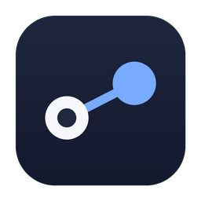
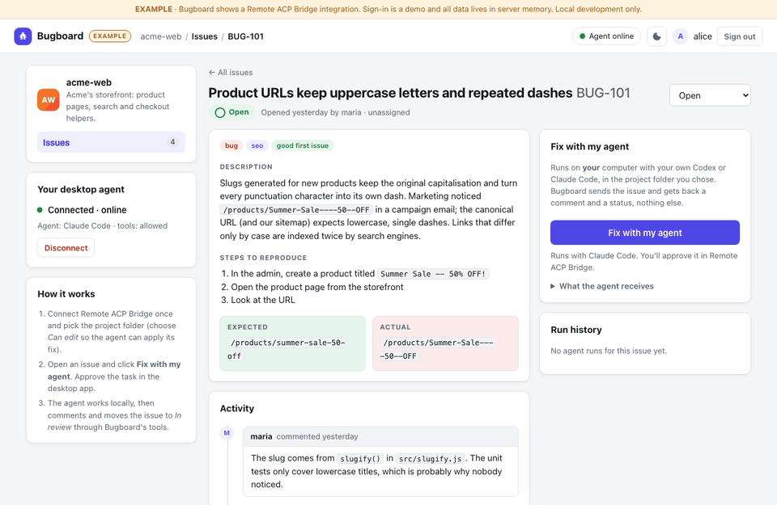
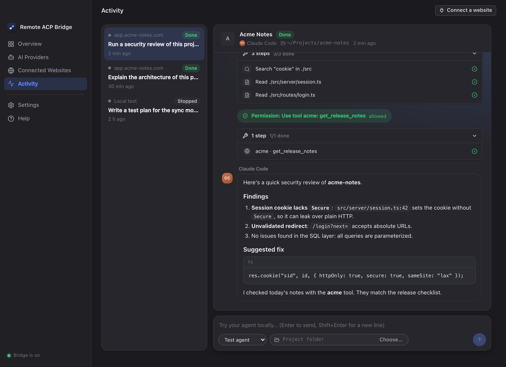
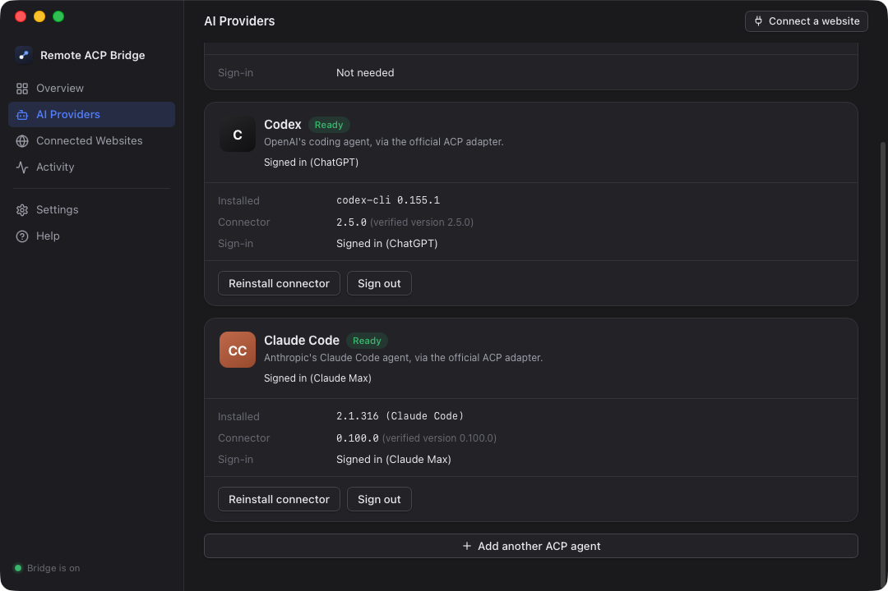
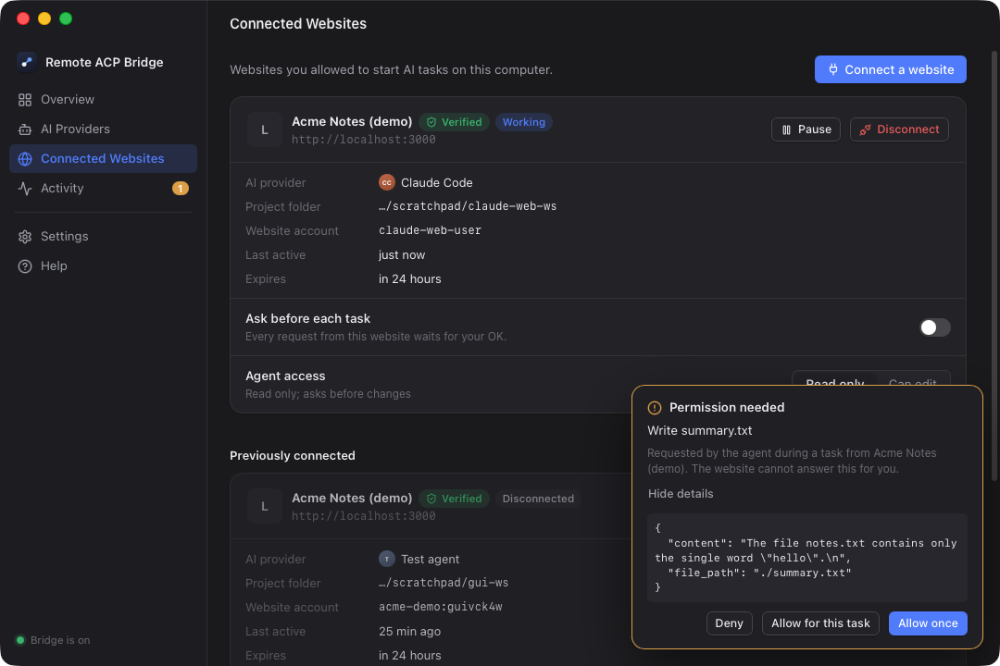
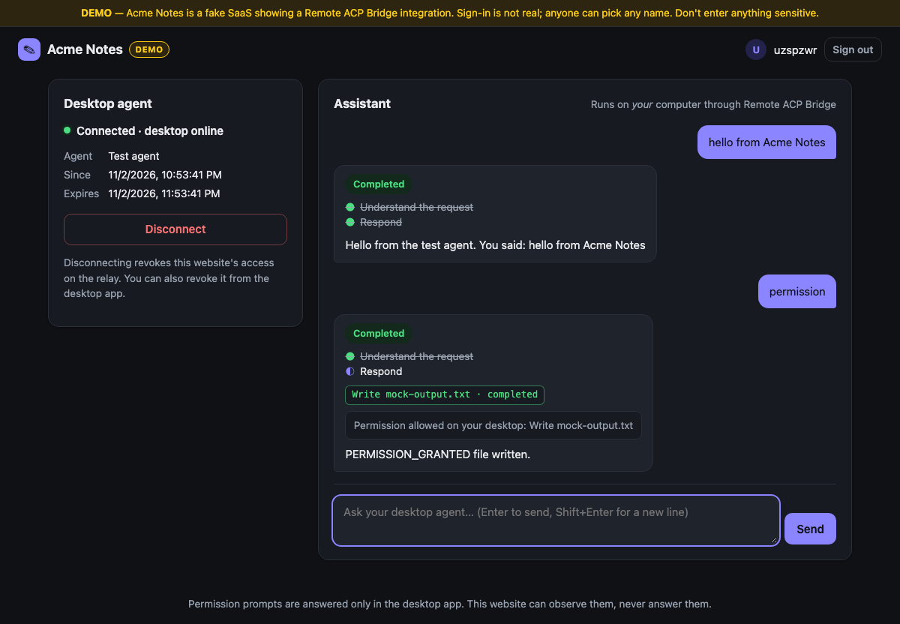
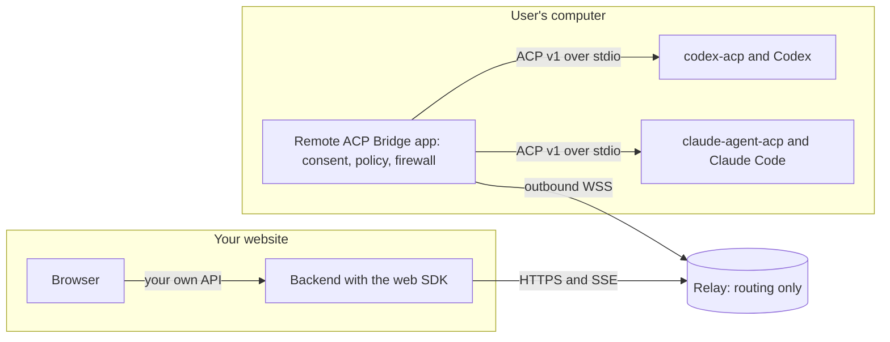
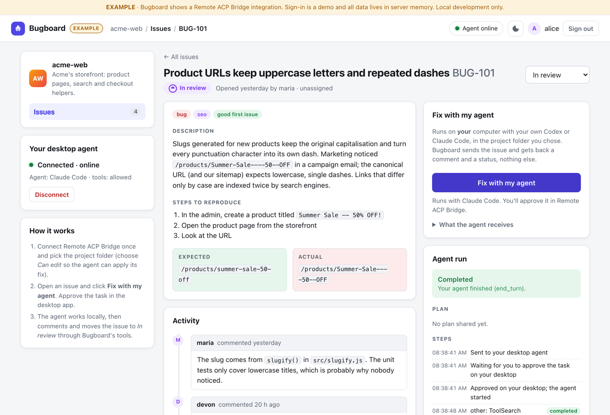

<div align="center">



# Remote ACP Bridge

**Use the AI coding agent on your own computer from websites you trust,<br/>while sign-in, files, permissions and execution stay on your machine.**

[](https://github.com/brstic/remote-acp/actions/workflows/ci.yml)
[](https://github.com/brstic/remote-acp/releases/latest)
[](LICENSE)


[How it works](#how-it-works) · [Quick start](#quick-start) · [Integrate your website](#integrate-your-website) · [Security](#security-model) · [For AI agents](#for-ai-coding-agents) · [Docs](#documentation)

</div>

---

Remote ACP Bridge is a desktop app plus a small relay and a web SDK. A website can send a task to
**Codex** or **Claude Code** running on your laptop, using **your own official sign-in**. The website
watches the agent work live. You approve what it may do. Nothing runs on your machine without your
consent, and no AI credentials ever leave it.

<p align="center"><br/><sub><b>Real run, not staged:</b> the Bugboard example sends a bug to the user's own Claude Code. The agent fixes it on the user's computer, runs the tests, and moves the issue to <i>In review</i> through the site's own MCP tools. Every action is approved in the desktop app.</sub></p>

<p align="center"><br/><sub><b>Activity</b>: a website's task running on the user's Claude Code, with the site's own instructions and tools, the plan, tool steps, a local permission and a formatted answer.</sub></p>

<table>
<tr>
<td width="50%"><br/><sub><b>AI Providers</b>: official ACP adapters, official sign-in, verified versions.</sub></td>
<td width="50%"><br/><sub><b>Local permission prompts</b>: the website can watch, but only you can approve.</sub></td>
</tr>
<tr>
<td colspan="2"><br/><sub><b>A website using the bridge</b>: streamed answer, plan, tool calls and permission status.</sub></td>
</tr>
</table>

## Why

- **Bring your own agent.** Your users already pay for Codex or Claude Code. With the bridge, your website can use the agents they already have, with no API keys, no shared accounts and no proxying of credentials.
- **Local-first and private.** The agent runs on the user's machine, in a project folder they choose. The relay forwards events and stores no prompts or results.
- **Safe by default.** Every connection needs explicit consent. Tasks need approval (on by default). Sensitive actions prompt locally. Agents run in restricted modes, and an output firewall blocks file access outside the project folder.
- **Simple to integrate.** Add a "Connect desktop agent" button, call `startTask()`, and stream events. There's a typed TypeScript SDK, and a plain REST + SSE API for any other language.

## How it works



1. **Pair.** The website shows *Connect desktop agent* (a one-time `remoteacp://` link or a 10-character code). The app shows the relay-verified site identity. The user picks an agent, a project folder and an access level, then clicks **Allow connection**.
2. **Task.** The website's backend calls `startTask()`. The app asks the user (if enabled), starts the agent in a restricted mode, and runs the prompt over the [Agent Client Protocol](https://agentclientprotocol.com).
3. **Stream.** Text, plan, tool calls and permission status stream back to the website as sanitized events. Either side can cancel, and the user can pause or disconnect at any time.

The desktop app only makes **outbound** connections. No ports are opened, and no router setup is needed.

## Quick start

**Just want to try the app?** Download it from the [latest release](https://github.com/brstic/remote-acp/releases/latest): `.dmg` (macOS), `.msi`/`.exe` (Windows), `.AppImage`/`.deb`/`.rpm` (Linux), plus relay binaries. Preview builds are unsigned (see the release notes). To build from source:

> **Prerequisites:** Rust (stable), Node.js 22+, pnpm 9. On macOS you also need the Xcode Command Line Tools. On Linux you need the WebKitGTK 4.1 dev packages (see `.github/workflows/ci.yml`).

```sh
git clone https://github.com/brstic/remote-acp.git && cd remote-acp
pnpm install && pnpm -r --filter '!remote-acp-desktop' build
pnpm --dir apps/desktop install --ignore-workspace
```

Then run three things (each in its own terminal):

```sh
pnpm --filter @remote-acp/web-demo relay      # 1. relay on 127.0.0.1:8787
pnpm --filter @remote-acp/web-demo dev        # 2. demo website on http://127.0.0.1:3000
pnpm --dir apps/desktop tauri dev             # 3. desktop app (or: pnpm --dir apps/desktop tauri build)
```

1. In the app, open **AI Providers**. Click **Install connector** for Codex and/or Claude Code, then sign in with the official flow (`codex login` / `claude auth login`). The built-in **Test agent** works without any AI account.
2. Open the demo website, sign in with any name, and click **Connect desktop agent**.
3. Approve the connection in the app, then send a prompt from the website. Try `permission` and `slow` with the Test agent to see permission prompts and cancellation.

Closing the window keeps the app running in the background, so websites can still reach your agent. Quit from the menu bar icon or with ⌘Q.

## Integrate your website

```ts
import { RemoteAcp } from "@remote-acp/web-sdk";        // server-side only

const bridge = new RemoteAcp({ serviceId, serviceSecret, relayUrl });

// 1. "Connect desktop agent" for the signed-in user
const pairing = await bridge.createPairing({ externalUserId: user.id });
//    → show pairing.url (button) and pairing.code; then:
const { connectionId } = await bridge.waitForPairing(pairing.pairingId);

// 2. Run a task on the user's own agent
const task = await bridge.startTask({
  connectionId, externalUserId: user.id,
  prompt: "Review this project for security issues. Do not modify files.",
  idempotencyKey: crypto.randomUUID(),
});

// Optional: your own system instructions and your own tools (MCP servers on your domain)
await bridge.startTask({
  connectionId, externalUserId: user.id, prompt: "What changed in today's release?",
  instructions: "You are the Acme Notes assistant. Cite file:line. Never modify files.",
  tools: [{ name: "acme", url: "https://app.acme.com/mcp", headers: [{ name: "Authorization", value: `Bearer ${token}` }] }],
});

// 3. Stream progress (auto-resumes on network drops)
for await (const ev of bridge.streamEvents(task.taskId)) {
  if (ev.kind === "task.event" && ev.payload.type === "text_delta") res.write(ev.payload.text);
}
```

📘 **[Integration guide](docs/integration-guide.md)**: registration, pairing UI, SSE proxying, permission UX, error codes, a security checklist, and Express and Next.js recipes.

### Real-world example: "Fix with my agent"

<p align="center"></p>

An issue tracker sends a bug to the user's **own** agent. The agent fixes the code **on the user's computer**,
runs the tests, and reports back through the tracker's own MCP tools. The tracker pays nothing for inference,
never sees the repository, and never touches an AI credential. See [`examples/issue-tracker`](examples/issue-tracker).

### Example apps

| Example | What it shows |
|---|---|
| [`examples/issue-tracker`](examples/issue-tracker) ⭐ | **Real-world flagship ("Bugboard"):** "Fix with my agent" on a bug. The user's own Codex or Claude Code fixes it locally, runs the tests, then comments and moves the issue to *In review* through the site's own MCP tools. Includes a sample project with a real bug and a real-agent test |
| [`examples/minimal-integration`](examples/minimal-integration) | The smallest complete integration, commented to be read top to bottom |
| [`examples/code-review-assistant`](examples/code-review-assistant) | A real product: structured review prompts, a live report, plan checklist and tool timeline |
| [`examples/docs-generator`](examples/docs-generator) | Tasks that write files: local permission prompts, outcomes, error handling, disconnect |
| [`examples/web-demo`](examples/web-demo) | A multi-user chat demo ("Acme Notes") |

## Features

| | |
|---|---|
| **Agents** | Codex (`@agentclientprotocol/codex-acp` 2.5.0) and Claude Code (`@agentclientprotocol/claude-agent-acp` 0.100.0), both via their official ACP adapters with official sign-in. Any other ACP agent can be added (hash-pinned). Plus a built-in Test agent. |
| **Consent** | Per-site connection with project folder, access level (*Read only* / *Can edit*) and expiry. Per-task approval. Local permission prompts (*Deny / Allow once / Allow for this task*). |
| **Customization** | Websites can send their own **system instructions** (appended to the agent's system prompt) and their own **tools** as MCP servers on their verified domain (requires the user's `agent.tools` consent). This works with both Codex and Claude Code. |
| **Control** | Pause the whole bridge, pause or disconnect one site, disconnect all, stop any task. Closing the window keeps it running in the background. |
| **Desktop UI** | Overview, AI Providers, Connected Websites, live Activity (with local test prompts), Settings, Diagnostics with an audit log, light and dark themes, notifications, menu bar icon, `remoteacp://` deep links. |
| **Relay** | Authenticated services, single-use pairing tickets, tenant and user isolation, idempotent at-most-once task dispatch, SSE with `Last-Event-ID` resume, rate limits, revocation, domain verification. |
| **SDK** | Typed TypeScript client with an auto-resuming SSE stream. Browser helper for the pairing button and code. Protocol types. |

## Security model

| Threat | What the bridge does |
|---|---|
| A website pretends to be another brand | Identity comes from the relay's registry, never from the link. Unverified sites get a red warning. |
| A prompt tries to reach `~/.ssh`, `/etc`, other folders | Agents run in restricted modes (`read-only` / `default`). An **output firewall** checks every tool call and permission request for paths outside the project folder: it denies the request or stops the task, and nothing more is sent. |
| The agent leaks credentials in its answer | Outgoing text is scanned for private keys and common token formats. If found, the task is stopped. |
| A website aims the agent at local or LAN services through "tools" | Tool servers must be on the website's own verified domain (https). They need explicit `agent.tools` consent, and they're shown to the user on the task. |
| The website approves its own permission prompt | There is no API for that. Permissions are answered only in the desktop app. |
| Replay, duplicates or network loss | Single-use tickets, per-task sequence numbers, idempotency keys, at-most-once dispatch, resend-on-reconnect. |
| Cross-tenant access | Every object is bound to the service and to the external user the desktop consented to. Anything else gets a 404. |
| Credential theft | Sign-in stays in the official CLIs. The bridge never reads `~/.codex` or `~/.claude`, and never forwards account info. |

Details: [SECURITY.md](SECURITY.md) · [Threat model](docs/threat-model.md) · [Provider notes](docs/provider-compliance.md)

## Repository layout

```
apps/
  desktop/            Tauri 2 app: src/ (React UI) · src-tauri/ (Rust shell, deep links, tray)
  relay/              Axum relay server (REST + SSE for services, WSS for desktops)
crates/
  bridge-protocol/    versioned envelope, validation, sender allowlists
  agent-host/         ACP v1 client: subprocess, NDJSON framing, permissions, mock agent
  connection-policy/  workspace confinement, grants, access levels, forbidden modes
  bridge-core/        desktop engine: relay client, task broker, sessions, providers, firewall, store
packages/
  web-sdk/            @remote-acp/web-sdk: server-side SDK
  browser-helper/     @remote-acp/browser-helper: pairing button and code
  protocol-types/     @remote-acp/protocol-types
examples/             minimal-integration · code-review-assistant · docs-generator · web-demo
tests/                contract fixtures · Rust E2E · Node E2E · real-agent suites · GUI E2E procedure
deploy/relay/         Dockerfile + Caddy (automatic TLS) for a public relay
docs/                 integration guide, architecture, protocol, threat model, deployment, troubleshooting
```

## Testing

```sh
cargo test --workspace                                    # protocol, ACP host, policy, relay + desktop E2E
pnpm -r --filter '!remote-acp-desktop' test               # SDK, helper, examples, Node E2E (real relay + headless desktop)
pnpm --dir apps/desktop test                              # every desktop screen and action
cargo test -p e2e-tests --test real_agents --test real_codex -- --ignored --test-threads=1
                                                          # real Codex + Claude Code via ACP (uses your own sign-in)
```

The real-agent suites cover: adapter install with integrity check, `initialize`, restricted modes,
streamed replies, reads inside the workspace, real permission prompts (deny means no file, allow
means file written), cancellation, the full website path, and the output firewall. See
[PROGRESS.md](PROGRESS.md) for current results and known limitations.

## For AI coding agents

If you are an AI agent working in this repository, start here:

- **Read first:** [`AGENTS.md`](AGENTS.md) / [`CLAUDE.md`](CLAUDE.md) (commands and rules), [`PLAN.md`](PLAN.md) (product spec), [`DECISIONS.md`](DECISIONS.md), [`SECURITY.md`](SECURITY.md), [`PROGRESS.md`](PROGRESS.md).
- **Build and test:** `cargo test --workspace` · `pnpm -r --filter '!remote-acp-desktop' test` · `pnpm --dir apps/desktop test`. Run `source ~/.cargo/env` if cargo is missing.
- **Invariants you must keep:**
  - All website requests go through `bridge-core` policy. The website-facing message set is the allowlist in `crates/bridge-protocol`. Extending it requires updating `SECURITY.md` and tests.
  - Never read provider credential caches. Never forward adapter account info (`_auth/status_update`).
  - Never select permissive agent modes (`auto`, `agent`, `bypassPermissions`, `*full-access*`) for website tasks.
  - The website must never be able to answer permission prompts.
- **Deterministic test agent:** prompt keywords `permission`, `read <path>`, `leak <path>`, `secret`, `slow`, `crash`, `noise`, `flood`.
- **Integrating a website?** Follow [docs/integration-guide.md](docs/integration-guide.md), and copy from `examples/minimal-integration`.

## Documentation

| Doc | |
|---|---|
| [Integration guide](docs/integration-guide.md) | Add Remote ACP Bridge to an existing website |
| [Architecture](docs/architecture.md) | Components and task flow |
| [Protocol](docs/protocol.md) | Bridge envelope v1 and the REST API |
| [Threat model](docs/threat-model.md) | Threats, mitigations, tests |
| [Providers](docs/provider-compliance.md) | Codex and Claude Code: adapters, sign-in, modes |
| [Deployment](docs/deployment.md) | Run a public relay (Docker + automatic TLS), signed releases |
| [Troubleshooting](docs/troubleshooting.md) | Common problems |

## Status

Working on macOS, tested end to end with real Codex and Claude Code. The full Rust and TypeScript test
suites pass in CI on macOS, Windows and Linux, CI launches the desktop app on all three, and
clicks through the real UI with WebDriver on Windows and Linux. Not done yet: code signing and notarization, auto-update, end-to-end encryption, a hosted
public relay. See [PROGRESS.md](PROGRESS.md).

## License

[Apache-2.0](LICENSE). Codex, Claude and Claude Code are trademarks of their respective owners. This project is not affiliated with OpenAI or Anthropic.
